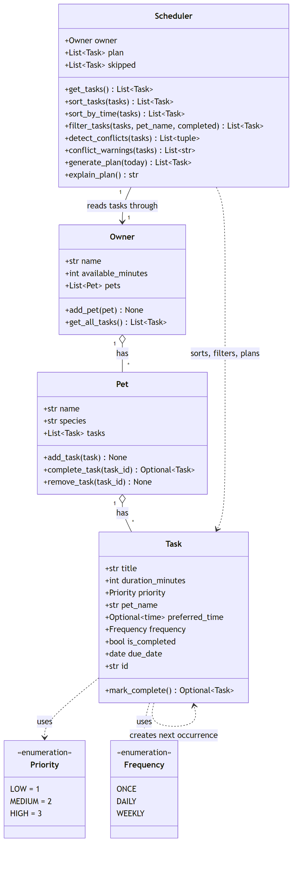

# 🐾 PawPal+ — Applied AI System (CodePath AI110 Capstone)

## The original project

PawPal+ began as the **CodePath Module 2 project**: a Streamlit app that helps a busy pet owner plan their day, built from four plain Python classes (`Task`, `Pet`, `Owner`, `Scheduler`) that sort care tasks by priority, filter them by pet and status, detect time conflicts, and greedily fit as many as possible into the minutes the owner has available. That original system was deliberately *advisory* — it could tell you that two tasks clashed, but it had no authority to do anything about it. This capstone extends it into an **applied AI system** by adding an agentic validation loop that diagnoses a schedule, repairs it, verifies the repair against pet-care safety and nutrition goals, and decides for itself whether the result is good enough to approve.

## Summary

PawPal+ turns a list of pet care tasks into a daily schedule and then **reviews its own work**. The scheduler produces a draft plan; a four-stage agent (**Planner → Executor → Evaluator → Reflector**) then finds missing care steps, overlapping times and feeding problems, fixes what it safely can, re-checks the result, and either approves the schedule or escalates the remainder to the human. Every review writes a timestamped reasoning trace to `ai_interactions.md`, so each decision the agent made can be audited after the fact.

**Every scheduling decision is deterministic and rule-based.** Google Gemini is layered on top to narrate the audit trail in plain English and to *propose* slots for missing care — but a proposal is only used if it passes the same validation a rule-chosen slot faces, and the whole system runs unchanged with no API key at all. The "AI" here is the agentic control loop and the domain rules it reasons against, augmented (never governed) by an LLM, which means every scheduling outcome is reproducible and explainable by reading the code.

**User-first.** A time you type is a commitment: the agent plans *around* your times and never silently moves them.

---

## 🤖 The AI feature (rubric: Agentic Workflow + Reliability)

PawPal+ implements **two** of the required AI features, both integrated into the main
application logic rather than bolted on as scripts:

1. **Agentic workflow** — a four-stage Planner → Executor → Evaluator → Reflector loop
   that plans, acts, verifies its own work, and decides whether to iterate again or
   escalate to the human. It genuinely edits the schedule; it is not a dry run.
2. **Reliability / testing system** — 35 automated tests, a randomised fuzz harness
   (400 configs × 8 runs), explicit guardrails (time budget, user-time locking,
   medication pinning), and a validation gate that re-checks every LLM suggestion.

Google Gemini (`google-genai`) augments the loop with plain-English audit commentary
and AI-proposed scheduling slots — always **advisory**, never authoritative. See
[§4 of the architecture](#4-ai-augmentation-layer--google-gemini-google-genai).

---

## 🏗️ Architecture Overview

Source: [`diagrams/architecture.mmd`](diagrams/architecture.mmd) (Mermaid flowchart).

The system is four layers. Data flows down from the UI into the core model, out through the agentic loop, and back to both the UI and the log file.

### 1. Streamlit UI — `app.py`

The presentation layer, and the only layer that knows Streamlit exists. It renders the owner/pet/task forms, the filtered task table with conflict warnings, the **Generate schedule** button, and — in the sidebar — the **Run Agentic Review** trigger. When a review finishes it renders the verdict banner, run metrics, one expander per loop step, and the revised schedule. The agent object is kept in `st.session_state` so the audit trail survives Streamlit's script reruns.

### 2. Core Logic — `pawpal_system.py`

The domain model and scheduling brain, importable and testable with no UI:

- `Owner` → `Pet` → `Task` is a simple composition chain; an owner has pets, a pet has tasks.
- `Scheduler` reads every task through `Owner.get_all_tasks()`, then sorts, filters, detects conflicts and produces the draft plan.
- **Care rules** live as module-level constants (`REQUIRED_CARE` per species, `SAFE_WINDOW`, `MIN_FEEDING_GAP_MINUTES`, `PINNED_KEYWORDS`). The diagram draws these as their own node because they are *shared knowledge*, not logic owned by any single stage — three of the four agent stages read them.

### 3. The Agentic Loop — `PetCareAgent.run()`

The loop starts from `Scheduler.generate_plan()` and cycles up to `max_iterations` times:

| Stage | Role | What it actually does |
|---|---|---|
| **1. Planner** | Diagnose | Reads the schedule and emits `Issue` objects: required care steps missing for a species, tasks with no time, and overlapping time windows. **Never edits anything.** |
| **2. Executor** | Repair | Acts on those issues: creates missing care tasks, assigns times to untimed tasks, moves the later task of each overlap, spaces out feedings, then reorders the day chronologically. |
| **3. Evaluator** | Verify | Independently re-checks the *revised* schedule against goals the Executor was not told to optimise for — safety (no residual overlaps, time-critical care inside `SAFE_WINDOW`) and nutrition (at least two feedings, at least six hours apart). |
| **4. Reflector** | Decide | Approves, or sends the remaining violations round again, or stops and escalates. |

Two edges in the diagram carry the parts that make this a genuine loop rather than a pipeline:

- **`Reflector → Planner` ("REVISE: carry violations into the next iteration").** The Evaluator's findings are fed back into the next iteration's Executor. Without this edge the Evaluator could detect a problem that nothing was ever able to fix, and the loop would spin until its budget ran out.
- **`Executor → Pet`.** The Executor mutates the real `Pet` and `Task` objects. The review is not a dry run — it genuinely edits your schedule.

The Reflector stops on any of three conditions: nothing left to fix (**approved**), the iteration budget is spent, or an iteration made **no progress** (the same number of issues as the previous pass), which means further iterations would only repeat themselves.

### 4. AI Augmentation Layer — Google Gemini (`google-genai`)

The system calls Gemini through the official SDK (`from google import genai`,
`client.models.generate_content()`) in two places. Both are **advisory**, and that
boundary is the single most important design decision in the project:

| Where | What the model does | What it is prevented from doing |
|---|---|---|
| **Planner / Reflector** | Narrates findings and the verdict in plain English for the audit trail | Changing a finding, or claiming a plan is safe when issues remain |
| **Executor** | Proposes a clock time for a missing second feeding | Writing that time itself — every suggestion must pass `_slot_acceptable()` |

`_slot_acceptable()` re-checks a proposed time against exactly the rules a rule-chosen
slot must satisfy: inside a named day block, inside `SAFE_WINDOW`, no clash with an
existing task, and at least `MIN_FEEDING_GAP_MINUTES` from every other feeding. A
suggestion that fails is **logged as rejected** and the deterministic slot is used
instead. A hallucinated time cannot reach a schedule.

The layer is fully optional. With no `GEMINI_API_KEY`, no `google-genai` install, or a
failed call, every method returns `""` and the loop behaves exactly as it does offline.
The 35-test suite never touches the network, because `PetCareAgent` defaults to
`commentator=None`.

### 5. Run Logging — `ai_interactions.md`

`format_agent_run()` renders a completed run as Markdown — source, owner, pets, iterations, start/finish timestamps and elapsed milliseconds, a per-step reasoning-trace table, and the final schedule. `log_agent_run()` appends it to `ai_interactions.md` in the project root under a dedicated `## Agentic Loop Run Log (auto-generated)` heading, leaving the hand-written notes above that heading untouched. The UI catches write failures and surfaces them as an error rather than losing the review.

---

## ⚙️ Setup

**Requirements:** Python 3.10 or newer (developed on 3.14).

**1. Clone and enter the project**

```bash
git clone <your-repo-url>
cd Applied-AI-System-Project
```

**2. Create a virtual environment**

```bash
python -m venv .venv
```

**3. Activate it**

```bash
# Windows (PowerShell)
.venv\Scripts\Activate.ps1

# Windows (Git Bash)
source .venv/Scripts/activate

# macOS / Linux
source .venv/bin/activate
```

**4. Install dependencies**

```bash
pip install -r requirements.txt
```

**5. Add a Gemini API key (optional)**

The scheduler, the agentic loop and all guardrails work **without a key**. A key only
adds plain-English commentary and AI-suggested slots.

```bash
cp .env.example .env     # then open .env and paste your key
```

```ini
# .env  (gitignored - never committed)
GEMINI_API_KEY=your-gemini-api-key-here
GEMINI_MODEL=gemini-3.5-flash     # optional; this is the default
```

Get a key from [aistudio.google.com/apikey](https://aistudio.google.com/apikey).
Without one the app simply shows `⚪ AI commentary off` in the sidebar and runs
rules-only.

> **Free-tier quota:** Google's free tier allows **20 `generate_content` requests per
> day**. One agentic review is capped at `LLM_MAX_CALLS_PER_RUN = 4`, so a key supports
> roughly five reviews a day. Past that the API returns `429 RESOURCE_EXHAUSTED`, which
> the system reports and absorbs — the schedule is still produced by the rules.

**6. Verify the install**

```bash
python -m pytest
```

You should see `35 passed`.

### Running the app

```bash
streamlit run app.py   # the full Streamlit app, opens in your browser
python main.py         # headless CLI demo of the scheduler, no UI needed
python demo.py         # all four evidence scenarios below, end to end
```

`demo.py` regenerates every example in the next section. Its captured output is also
committed as [`demo_output.txt`](demo_output.txt).

To run an agentic review in the UI: add a pet and at least one task, then open the **sidebar** and click **Run Agentic Review**.

---

## 🔁 Reproducible Examples

All three examples below are **real captured output**, not illustrations. Example 1 is fully deterministic. Examples 2 and 3 are deterministic in their reasoning and final schedule; only the wall-clock timestamps in the log differ between runs.

### Example 0 — User-first scheduling: your times are never moved

The most important behavioural guarantee. The owner types a 13:30 lunch and a 07:00
walk; the agent fills the gaps **around** them and leaves both exactly where they were.

```text
INPUT (typed by the owner):
  Timmy (dog) - Lunch feed 13:30 (30 min), Morning walk 07:00 (20 min)
  Available time today: 600 min

OUTPUT (after the agentic review):
  07:00  Timmy    Morning walk            20 min  [set by you]
  07:30  Timmy    Second feed Timmy       15 min  [set by agent]
  13:30  Timmy    Lunch feed              30 min  [set by you]
  18:00  Timmy    Water Timmy             15 min  [set by agent]

  Lunch feed still at 13:30: True
  Morning walk still at 07:00: True
  Verdict: APPROVED

  [Gemini / PLANNER] Timmy's schedule currently includes his morning walk and lunch
  feed, but there is no water task scheduled for him today. Proper hydration is
  essential for his health and overall wellbeing. Please add a water task to ensure
  his daily care plan is complete and safe.
```

A task the owner leaves **untimed** is still placed by the agent — no preference was
expressed, so there is nothing to override. Only an explicit time is treated as a
commitment (`_is_user_fixed()`).

### Example 0b — The LLM guardrail, suggestion by suggestion

Gemini is asked where a second feeding belongs for a dog already fed at 13:30. Each
reply is re-checked by `_slot_acceptable()` before it can be used. Reproduce with
`python demo.py` (this scenario uses a stub model, so it needs no API key or quota):

```text
  Model says   Verdict    Placed at   Why
  ---------------------------------------
  19:30        ACCEPTED   19:30       6h00 after 13:30, inside evening block
  07:30        ACCEPTED   07:30       6h00 before 13:30, inside morning block
  19:00        REJECTED   07:30       only 5h30 from 13:30 - under the minimum
  14:00        REJECTED   07:30       only 30 min from 13:30
  02:00        REJECTED   07:30       outside the safe window and every block
  banana       REJECTED   07:30       unparseable reply

  A rejected suggestion falls back to the rule-chosen slot.
  A hallucinated time can never reach the schedule.
```

Note `19:00` being rejected: it looks reasonable to a human, but 13:30 → 19:00 is
5h30, under the 6-hour nutritional minimum. The rules catch what eyeballing misses.

### Example 1 — The scheduler alone (`python main.py`)

One owner, two pets, six tasks added deliberately out of order, with a clash introduced on purpose.

**Input:** run `python main.py` from the project root.

**Output (final section):**

```
Conflict check after adding two tasks at 09:00
----------------------------------------------
Warning (different pets): 'Vet call' (Rex, 09:00) overlaps 'Brushing' (Mia, 09:00)

Today's plan (90 min available)
-------------------------------
   08:00  Breakfast      Mia    10 min  [high  ] todo
   09:00  Vet call       Rex    20 min  [medium] todo
   09:00  Brushing       Mia    10 min  [low   ] todo
   12:00  Medication     Mia     5 min  [high  ] todo
any time  Fetch          Rex    15 min  [medium] todo

Why this plan:
Planned 60 of 90 available minutes (highest priority first, then earliest preferred time, then shortest).
- Mia: Breakfast (10 min, high) at 08:00
- Mia: Medication (5 min, high) at 12:00
- Rex: Vet call (20 min, medium) at 09:00
- Rex: Fetch (15 min, medium)
- Mia: Brushing (10 min, low) at 09:00
- Skipped Rex: Grooming (40 min, low): not enough time left
Warning (different pets): 'Vet call' (Rex, 09:00) overlaps 'Brushing' (Mia, 09:00)
```

Note what the *pre-agent* system does with that conflict: **it plans both clashing tasks anyway and merely warns.** `Grooming` (40 min) was skipped for lack of time, but the loop continued and `Fetch` (15 min) still fit. This is exactly the gap the agentic loop was built to close.

### Example 2 — An agentic review that gets approved

**Input** — save as `demo_review.py` in the project root and run `python demo_review.py`:

```python
from datetime import time
from pawpal_system import Owner, Pet, PetCareAgent, Priority, Task

owner = Owner(name="Jordan", available_minutes=300)
rex, mia = Pet(name="Rex", species="dog"), Pet(name="Mia", species="cat")
owner.add_pet(rex)
owner.add_pet(mia)

rex.add_task(Task("Morning feed", 20, Priority.HIGH, preferred_time=time(7, 0)))
rex.add_task(Task("Walk Rex", 30, Priority.MEDIUM, preferred_time=time(7, 10)))
mia.add_task(Task("Insulin dose", 5, Priority.HIGH, preferred_time=time(7, 0)))
mia.add_task(Task("Scoop litter", 10, Priority.LOW))   # no preferred time

agent = PetCareAgent(owner)
agent.run()
print(agent.explain_run())
```

**Output:**

```
Iter 0 | INPUT     | draft plan from Scheduler: 4 task(s)
    - Mia: Insulin dose at 07:00
    - Rex: Morning feed at 07:00
    - Rex: Walk Rex at 07:10
    - Mia: Scoop litter (untimed)
Iter 1 | PLANNER   | analyzed 4 task(s); found 6 issue(s)
    - [HIGH] missing_care: Rex (dog) has no 'water' task scheduled
    - [HIGH] missing_care: Mia (cat) has no 'feed' task scheduled
    - [HIGH] missing_care: Mia (cat) has no 'water' task scheduled
    - [HIGH] conflict: 'Insulin dose' (Mia, 07:00) overlaps 'Morning feed' (Rex, 07:00)
    - [HIGH] conflict: 'Morning feed' (Rex, 07:00) overlaps 'Walk Rex' (Rex, 07:10)
    - [MEDIUM] untimed: 'Scoop litter' (Mia) has no scheduled time
Iter 1 | EXECUTOR  | applied 6 adjustment(s)
    - added 'Water Rex' at 16:00 (missing 'water' care for Rex)
    - added 'Feed Mia' at 17:00 (missing 'feed' care for Mia)
    - added 'Water Mia' at 06:00 (missing 'water' care for Mia)
    - scheduled 'Scoop litter' (Mia) at 09:00
    - moved 'Morning feed' (Rex) 07:00 -> 12:00 to clear an overlap
    - moved 'Walk Rex' (Rex) 07:10 -> 08:00 to clear an overlap
Iter 1 | EVALUATOR | safety + nutrition check: FAIL (2 violation(s))
    - [HIGH] feeding_gap: Rex has 1 feeding(s); at least 2 are expected
    - [HIGH] feeding_gap: Mia has 1 feeding(s); at least 2 are expected
Iter 1 | REFLECTOR | REVISE - 2 issue(s) left, running another iteration
    - [HIGH] feeding_gap: Rex has 1 feeding(s); at least 2 are expected
    - [HIGH] feeding_gap: Mia has 1 feeding(s); at least 2 are expected
Iter 2 | PLANNER   | analyzed 7 task(s); found 0 issue(s)
    - schedule looks complete and conflict-free
Iter 2 | EXECUTOR  | applied 2 adjustment(s)
    - added 'Second feed Rex' at 21:30 so Rex gets two feedings
    - added 'Second feed Mia' at 21:00 so Mia gets two feedings
Iter 2 | EVALUATOR | safety + nutrition check: PASS
    - all safety and nutritional goals met
Iter 2 | REFLECTOR | APPROVED - schedule is safe, complete and well spaced
    - no outstanding issues; ending the loop

Final verdict: APPROVED after 2 iteration(s).
  06:00  Mia: Water Mia (15 min)
  07:00  Mia: Insulin dose (5 min)
  08:00  Rex: Walk Rex (30 min)
  09:00  Mia: Scoop litter (10 min)
  12:00  Rex: Morning feed (20 min)
  16:00  Rex: Water Rex (15 min)
  17:00  Mia: Feed Mia (15 min)
  21:00  Mia: Second feed Mia (15 min)
  21:30  Rex: Second feed Rex (15 min)
```

Three things this run demonstrates:

- **`Insulin dose` never moved.** It matches `PINNED_KEYWORDS`, so the Executor moved `Morning feed` out of its way instead of rescheduling medication.
- **The feedback loop did real work.** Iteration 1's Evaluator found a nutrition problem the Planner cannot see (it checks structure, not goals); iteration 2's Executor acted on it.
- **It stopped as soon as it was done** — two iterations of a three-iteration budget.

### Example 3 — A review that escalates instead of forcing a fix

Two medication tasks are scheduled five minutes apart. Both are pinned, so neither can be moved.

**Input:**

```python
from datetime import time
from pawpal_system import Owner, Pet, PetCareAgent, Priority, Task

owner = Owner(name="Jordan", available_minutes=300)
mia = Pet(name="Mia", species="cat")
owner.add_pet(mia)
mia.add_task(Task("Insulin dose", 10, Priority.HIGH, preferred_time=time(8, 0)))
mia.add_task(Task("Thyroid medication", 10, Priority.HIGH, preferred_time=time(8, 5)))

agent = PetCareAgent(owner, max_iterations=2)
agent.run()
print(agent.explain_run())
```

**Output (abridged to the decisive stages):**

```
Iter 1 | PLANNER   | analyzed 2 task(s); found 4 issue(s)
    - [HIGH] missing_care: Mia (cat) has no 'feed' task scheduled
    - [HIGH] missing_care: Mia (cat) has no 'water' task scheduled
    - [HIGH] missing_care: Mia (cat) has no 'litter' task scheduled
    - [HIGH] conflict: 'Insulin dose' (Mia, 08:00) overlaps 'Thyroid medication' (Mia, 08:05)
Iter 1 | EXECUTOR  | applied 4 adjustment(s)
    - added 'Feed Mia' at 07:00 (missing 'feed' care for Mia)
    - added 'Water Mia' at 07:30 (missing 'water' care for Mia)
    - added 'Litter Mia' at 09:00 (missing 'litter' care for Mia)
    - left 'Insulin dose' / 'Thyroid medication' overlapping: both are time-critical
Iter 2 | EXECUTOR  | applied 2 adjustment(s)
    - added 'Second feed Mia' at 17:00 so Mia gets two feedings
    - left 'Insulin dose' / 'Thyroid medication' overlapping: both are time-critical
Iter 2 | EVALUATOR | safety + nutrition check: FAIL (1 violation(s))
    - [HIGH] conflict: 'Insulin dose' still overlaps 'Thyroid medication'
Iter 2 | REFLECTOR | NOT APPROVED - iteration budget (2) exhausted
    - [HIGH] conflict: 'Insulin dose' still overlaps 'Thyroid medication'

Final verdict: NEEDS REVIEW after 2 iteration(s).
  07:00  Mia: Feed Mia (15 min)
  07:30  Mia: Water Mia (15 min)
  08:00  Mia: Insulin dose (10 min)
  08:05  Mia: Thyroid medication (10 min)
  09:00  Mia: Litter Mia (15 min)
  17:00  Mia: Second feed Mia (15 min)
```

This is the behaviour that matters most for a care system: **the agent fixed everything it legitimately could and refused to fake the rest.** Two medications five minutes apart is a question for a vet, not something a scheduler should quietly reshuffle — so it fixed four other problems, left the clash alone, said so explicitly, and handed the decision back with a `NEEDS REVIEW` verdict.

### What gets written to `ai_interactions.md`

Every review run in the Streamlit app appends an entry like this (from a two-task Rex-only run):

````markdown
### Run 2026-11-15 18:16:43 — APPROVED

- **Source:** streamlit app
- **Owner:** Jordan (300 min available)
- **Pets:** Rex (dog)
- **Iterations used:** 2 of 3
- **Started / finished:** 18:16:43 → 18:16:43 (0.3 ms)
- **Final schedule:** 4 task(s)

**Reasoning trace**

| Time | Iter | Stage | Summary | Details |
| --- | --- | --- | --- | --- |
| 18:16:43 | 0 | INPUT | draft plan from Scheduler: 2 task(s) | Rex: Morning feed at 07:00<br>Rex: Walk Rex at 07:10 |
| 18:16:43 | 1 | PLANNER | analyzed 2 task(s); found 2 issue(s) | [HIGH] missing_care: Rex (dog) has no 'water' task scheduled<br>[HIGH] conflict: 'Morning feed' (Rex, 07:00) overlaps 'Walk Rex' (Rex, 07:10) |
| 18:16:43 | 1 | EXECUTOR | applied 2 adjustment(s) | added 'Water Rex' at 16:00 (missing 'water' care for Rex)<br>moved 'Walk Rex' (Rex) 07:10 -> 08:00 to clear an overlap |
| 18:16:43 | 1 | EVALUATOR | safety + nutrition check: FAIL (1 violation(s)) | [HIGH] feeding_gap: Rex has 1 feeding(s); at least 2 are expected |
| 18:16:43 | 1 | REFLECTOR | REVISE - 1 issue(s) left, running another iteration | [HIGH] feeding_gap: Rex has 1 feeding(s); at least 2 are expected |
| 18:16:43 | 2 | PLANNER | analyzed 3 task(s); found 0 issue(s) | schedule looks complete and conflict-free |
| 18:16:43 | 2 | EXECUTOR | applied 1 adjustment(s) | added 'Second feed Rex' at 17:00 so Rex gets two feedings |
| 18:16:43 | 2 | EVALUATOR | safety + nutrition check: PASS | all safety and nutritional goals met |
| 18:16:43 | 2 | REFLECTOR | APPROVED - schedule is safe, complete and well spaced | no outstanding issues; ending the loop |

**Final schedule**

```
07:00  Rex: Morning feed (20 min)
08:00  Rex: Walk Rex (30 min)
16:00  Rex: Water Rex (15 min)
17:00  Rex: Second feed Rex (15 min)
```
````

---

## ✨ Features

### Scheduler (the original system)

| Feature | What it does | Implemented in |
|---|---|---|
| **Multi-pet task tracking** | One owner holds many pets, each pet holds its own tasks. Adding a task stamps it with the pet's name, so any task can say whose it is even after the lists are merged. | `Owner.add_pet()`, `Pet.add_task()`, `Owner.get_all_tasks()` |
| **Sorting by priority (planning order)** | Orders tasks high → medium → low; ties break on earliest preferred time, then shortest duration. Untimed tasks fall behind timed ones of the same priority. | `Scheduler.sort_tasks()` |
| **Sorting by time (chronological)** | Orders tasks purely by clock time, ignoring priority — the "what does my day look like" view. Untimed tasks go last. | `Scheduler.sort_by_time()` |
| **Filtering by pet and status** | Narrows a task list to one pet, to pending-only or done-only, or both at once (the filters AND together). | `Scheduler.filter_tasks()` |
| **Conflict detection** | Treats each task as occupying `[preferred_time, preferred_time + duration)` and returns every overlapping pair. Back-to-back tasks correctly do **not** conflict. | `Scheduler.detect_conflicts()` |
| **Conflict warnings** | Turns those pairs into readable sentences saying whether the clash is within one pet or between two. Advisory only. | `Scheduler.conflict_warnings()` |
| **Daily and weekly recurrence** | Completing a `DAILY` task returns a fresh pending copy due one day later; `WEEKLY` advances seven days, with a new id. `ONCE` tasks simply finish. | `Task.mark_complete()`, `Pet.complete_task()` |
| **Due-date awareness** | The planner only considers tasks due on or before the target day. Overdue tasks are still picked up. | `Scheduler.generate_plan(today=...)` |
| **Greedy time-budgeted planning** | Takes each task that fits the remaining minutes; one that doesn't fit is recorded as skipped and the loop continues, so an oversized task can't starve the day. | `Scheduler.generate_plan()` |
| **Plain-language explanation** | Reports minutes used vs. available, every planned task, every skipped task with its reason, and any conflicts. | `Scheduler.explain_plan()` |

### Agentic loop (the capstone extension)

| Feature | What it does | Implemented in |
|---|---|---|
| **Species-aware care checks** | Knows a dog needs feed/water/walk and a cat needs feed/water/litter, and flags any that are missing from the day. | `PetCareAgent.plan()`, `REQUIRED_CARE` |
| **Automatic conflict repair** | Moves the later task of an overlapping pair to the first genuinely free slot, preferring sensible times for that kind of care. | `PetCareAgent.execute()`, `_free_slot()` |
| **Pinned medication** | Tasks matching `PINNED_KEYWORDS` are never moved. If two pinned tasks clash, the agent says so instead of resolving it. | `_is_medication()` |
| **User-first time locking** | A time the owner typed is a commitment: the agent schedules around it and never shifts it. Untimed tasks are still placed freely. | `_is_user_fixed()`, `Task.source` |
| **Logical day blocks** | New care lands in morning (07:00-09:00), afternoon (13:00-15:00) or evening (18:00-20:00), choosing the least crowded suitable block. | `DAY_BLOCKS`, `_natural_slot()` |
| **AI audit commentary** | Gemini narrates the Planner's findings and the Reflector's verdict in plain English for the owner. | `LLMCommentator`, `client.models.generate_content()` |
| **AI-suggested slots, rule-validated** | Gemini proposes a time for a missing feeding; it is used only if it passes block, clash, spacing and safe-window checks. Accept/reject is logged. | `suggest_care_time()`, `_slot_acceptable()` |
| **Time-budget guardrail** | The plan never commits more minutes than the owner has. Care that will not fit is reported, not silently dropped. | `_fits_budget()`, `_defer()` |
| **Graceful LLM degradation** | Missing key, 429 quota, 504 timeout or unparseable output all fall back to rules with a clear message. | `LLMCommentator._generate()` |
| **Safety verification** | Confirms feeding, walks and medication fall inside `SAFE_WINDOW` (06:00–22:00) and that nothing still overlaps. | `PetCareAgent.evaluate()` |
| **Nutrition verification** | Requires at least two feedings per pet, at least `MIN_FEEDING_GAP_MINUTES` (6h) apart, targeting ~7h, and adds or re-spaces feedings to achieve it. | `PetCareAgent.evaluate()`, `PetCareAgent.execute()` |
| **Self-terminating iteration** | Stops on approval, on budget exhaustion, or on a no-progress iteration — it cannot spin forever. | `PetCareAgent.reflect()` |
| **Full audit trail** | Every stage records a `LoopStep` with timestamp, summary and details, rendered to both the UI and the log file. | `LoopStep`, `explain_run()`, `log_agent_run()` |

---

## 📐 Class Diagram

The class diagram below matches the shipped data model in `pawpal_system.py`. Source: [`diagrams/uml_final.mmd`](diagrams/uml_final.mmd).



An **Owner** aggregates **Pets**, a **Pet** aggregates **Tasks**, and the **Scheduler** holds one Owner and reads every task through it. `Task` depends on the `Priority` and `Frequency` enums, and on itself: a recurring task's `mark_complete()` returns the next occurrence. The agentic loop sits *on top of* this model — `PetCareAgent` holds an `Owner` and a `Scheduler` and mutates `Task` objects through them.

---

## 🧠 Design Decisions and Trade-offs

**Rules decide; the language model advises.** *(Revised when Gemini was added - this section previously read "Rules, not a language model".)* Every decision that affects an animal is still made by explicit constants and comparisons: what care a species needs, what counts as a conflict, how far apart feedings must be, whether a run is approved. Gemini is layered on top for two things only - narrating the audit trail, and *proposing* a slot that `_slot_acceptable()` then re-checks against those same rules. *Trade-off:* the system still cannot handle care instructions it has no rule for ("walk him less in the heat"); the model can describe that need but not act on it. *Why anyway:* for a system that moves medication times, a reproducible, inspectable decision is worth more than a flexible one. Every scheduling answer is still traceable to a line of code, still identical across runs, and still produced when the API is down, rate-limited, or absent.

**The user's clock beats the agent's.** A time the owner types is pinned (`_is_user_fixed()`); the Executor will not move it to resolve a conflict or a feeding gap. *Trade-off:* two overlapping owner-set times cannot be auto-resolved, so the run ends `NEEDS REVIEW` with the clash reported. *Why anyway:* silently rewriting someone's day to make the agent's own checks pass is the wrong trade. Medication keeps its separate pin for the same reason, and an untimed task is still placed freely - no preference was expressed, so there is nothing to override.

**A hard per-review call budget.** `LLM_MAX_CALLS_PER_RUN = 4`. *Trade-off:* on a multi-pet schedule some steps get rule-based placement with no model input. *Why anyway:* the Gemini free tier allows 20 requests **per day**. An uncapped loop would spend a whole day's quota in two reviews, so the cap buys predictable cost and graceful degradation instead of a mid-run failure.

**Keyword matching on task titles.** A task counts as a feeding if `"feed"` appears in its title. *Trade-off:* this is genuinely fragile — "Breakfast" is a feeding that the agent will not recognise, and it will helpfully add a redundant "Feed Mia" alongside it. *Why anyway:* the alternative is a task-type enum, which would force users to categorise every task through a dropdown and would break every task created before the change. A `care_type` field is the right fix and the clearest next step for this codebase.

**Separating Planner from Evaluator.** Both inspect the schedule, so they could have been one function. They are deliberately split: the Planner checks *structure* (is anything missing or overlapping?) while the Evaluator checks *goals* (is this schedule actually good for the animal?). *Why it matters:* the Evaluator judges the Executor's output against criteria the Executor was not handed, which is what makes the verification meaningful rather than a restatement of the repair.

**The Executor mutates real objects.** The agent edits the user's actual `Pet` and `Task` objects rather than working on a copy. *Trade-off:* there is no undo, which is why the sidebar carries an explicit warning. *Why anyway:* a review whose fixes evaporate when you close the expander would be theatre. A propose-and-confirm diff would be the better design and is the second clear next step.

**Stopping on no progress.** The Reflector halts when an iteration leaves the same number of issues as the last one. *Trade-off:* it can stop one iteration early in a case where a different repair would have helped on the next pass. *Why anyway:* the alternative is burning the full budget re-running identical work, and an agent that admits it is stuck is more useful than one that looks busy.

**Appending to `ai_interactions.md` under a fenced heading.** Run logs go *below* an auto-generated heading, never into the hand-written sections above it. *Trade-off:* the file grows without bound and has no rotation. *Why anyway:* the whole point of the log is an append-only audit trail, and a capstone-scale project will not produce enough entries to matter.

**Known limitations, pinned by tests:** time windows do not wrap around midnight (a 23:50 task lasting 30 minutes never conflicts with a 00:05 task), and completing an already-completed recurring task spawns a duplicate occurrence.

---

## 🧪 Testing

Run the full suite from the project root:

```bash
python -m pytest
```

```
============================= test session starts =============================
platform win32 -- Python 3.14.3, pytest-9.2.0, pluggy-None
rootdir: c:\Users\thevi\Applied-AI-System-Project
plugins: None-None
collected 35 items

tests\test_pawpal.py ..................................                  [100%]

============================= 35 passed in 0.11s ==============================
```

### What the 35 tests cover

| Area | Happy paths | Edge cases |
|------|-------------|------------|
| **Sorting** | `sort_tasks` applies all three keys in order (priority → preferred time → duration); `sort_by_time` is chronological | Timed tasks sort before untimed ones of the same priority; identical tasks keep insertion order; the two sorts deliberately disagree on a low-priority-early vs. high-priority-late pair; empty lists and input-not-mutated |
| **Recurrence** | Completing a `DAILY` task adds one pending task due the next day with a new id; `WEEKLY` advances seven days | `ONCE` tasks don't recur; weekly recurrence across a month boundary (Jan 28 → Feb 4); unknown task ids are a no-op; completing a task twice recurs twice (documented limitation) |
| **Conflict detection** | Same-time tasks flagged; overlapping windows flagged within one pet and across pets, labelled accordingly | Back-to-back tasks don't conflict (half-open windows); untimed tasks ignored; invalid `preferred_time` warns instead of crashing; zero-duration tasks never conflict; past-midnight does not wrap (documented limitation); empty and single-task lists |
| **Plan generation** | Tasks that fit are all planned; exact-fit budget leaves nothing skipped; `explain_plan` reports minutes, skip reasons and conflicts | Empty pets/owners yield an empty plan; zero available minutes skips everything; an oversized task is skipped but a later shorter one still fits; completed excluded, overdue included; re-running resets prior results |

### Reliability and guardrail evaluation

Structured results from `python demo.py` plus the fuzz harness described below. All
rows are reproducible; none are screenshots.

| # | Test input | Evaluation criteria | Result |
|---|---|---|---|
| 1 | Owner sets Lunch 13:30 + Walk 07:00 | Both times unchanged after review | **Pass** - 13:30 and 07:00 intact |
| 2 | Dog + cat, one feeding each, 600 min | Missing care added, 2 feedings/pet, 6h+ apart | **Pass** - APPROVED in 2 iterations, 120/600 min |
| 3 | Dog, 40 min of tasks, only 30 min available | Must not exceed budget; must escalate | **Pass** - committed 20/30, verdict NEEDS REVIEW |
| 4 | Gemini suggests `19:30` for a 2nd feeding | Accept (6h00 gap, evening block) | **Pass** - accepted, placed 19:30 |
| 5 | Gemini suggests `19:00` | Reject (5h30 < 6h minimum) | **Pass** - rejected, fell back to 07:30 |
| 6 | Gemini suggests `02:00` | Reject (outside safe window/blocks) | **Pass** - rejected, fell back to 07:30 |
| 7 | Gemini replies `banana` | Reject unparseable output | **Pass** - rejected, fell back to 07:30 |
| 8 | No `GEMINI_API_KEY` set | Loop completes, rules unaffected | **Pass** - APPROVED, commentary omitted |
| 9 | API returns `429 RESOURCE_EXHAUSTED` | Absorbed, schedule still produced | **Pass** - observed live; run completed |
| 10 | API returns `504 DEADLINE_EXCEEDED` | Absorbed, schedule still produced | **Pass** - observed live; run completed |
| 11 | 400 random configs x 8 repeat runs | No duplicate tasks; no budget overrun | **Pass** - 0/1200 duplicates, 0/1200 over budget |
| 12 | Same config re-reviewed 8 times | Task count converges, no multiplication | **Pass** - 0/400 configs changed after run 1 |

**Summary.** 35/35 unit tests pass in ~0.1s with no network access. The fuzz harness
(400 randomised owner/pet/task configurations, each reviewed 8 times) found zero
duplicate tasks, zero budget overruns, and full convergence after the first run.
Every LLM failure mode encountered in real use - quota exhaustion, server timeout,
missing key, unparseable output - degraded to rule-only behaviour without losing a
schedule. The two bugs this testing actually caught were a duplication bug (the
Planner judged "missing care" against the budget-trimmed plan instead of the pet's
real task list, inventing a duplicate every run) and an unbounded time commitment
(70 minutes scheduled against a 30-minute budget, reported as APPROVED).

### Coverage gap: the agentic loop is not yet unit-tested

**35 tests cover the original `Scheduler` plus one agent-level regression test. There are currently no automated tests for `PetCareAgent`, `Issue`, `LoopStep` or `log_agent_run`.** The loop has been verified manually — the three examples above are captured from real runs, and the Streamlit integration was exercised end to end with `streamlit.testing.v1.AppTest` (button click → nine stage expanders → `APPROVED` verdict → log entry on disk) — but manual verification is not a regression suite.

The highest-value tests to add next, roughly in order:

1. The Reflector's three stop conditions (approval, budget exhaustion, no-progress), since an infinite loop is the worst failure mode here.
2. Pinned medication is never moved, including the two-pinned-tasks-clash escalation in Example 3.
3. The Evaluator's nutrition rules at the boundary — exactly `MIN_FEEDING_GAP_MINUTES` apart should pass, one minute less should fail.
4. `log_agent_run` preserves hand-written content above the auto-generated heading and creates that heading exactly once.

### Confidence level: ★★★☆☆ (3 / 5)

The scheduling core earns four stars on its own: every documented behaviour has a passing test, including the empty-state and tie-breaking cases that usually hide bugs. The overall system drops to three because the newest and most consequential component — the agent that rewrites your pet's schedule — rests entirely on manual verification. The loop demonstrably works on the scenarios above, including the one where it correctly refuses to act, but until items 1–4 above are written, a regression in the agent would ship silently.

---

## 🪞 Reflection (brief)

> The graded responsible-AI reflection lives in **[`model_card.md`](model_card.md)** —
> limitations and biases, misuse and guardrails, reliability surprises, and the AI
> collaboration notes. This is only a short note, as the rubric specifies.

Building this taught me that the hard part of an applied AI system is deciding what the
AI is *allowed* to decide. The scheduler was easy; drawing the line between "the agent
may fill a gap you left" and "the agent may not move a time you chose" took longer than
writing the loop. Adding Gemini made the same question concrete a second time — the
model is genuinely useful for explaining a schedule to an owner, and genuinely unsafe as
the thing that picks a feeding time, so it does the first and only proposes the second.

The other lesson was that external services fail in ways documentation does not predict.
A `404` on a documented model, a `504` that hung for 48 seconds, and a `429` revealing a
20-request daily cap each produced a code change. None of them can break a schedule,
because the rules never depended on the model — which is the whole argument for building
it that way.

---

## 📄 Related documents

- [`diagrams/architecture.mmd`](diagrams/architecture.mmd) — system architecture diagram
- [`diagrams/uml_final.mmd`](diagrams/uml_final.mmd) / [`.png`](diagrams/uml_final.png) — class diagram
- [`ai_interactions.md`](ai_interactions.md) — hand-written AI collaboration notes, plus the auto-generated agent run log
- [`reflection.md`](reflection.md) — design reflection
- [`model_card.md`](model_card.md) — limitations, biases, misuse risks and guardrails, reliability findings, and AI collaboration notes (**the graded reflection**)
- [`demo.py`](demo.py) / [`demo_output.txt`](demo_output.txt) — the four evidence scenarios and their captured output
- [`.env.example`](.env.example) — template for the optional `GEMINI_API_KEY`
